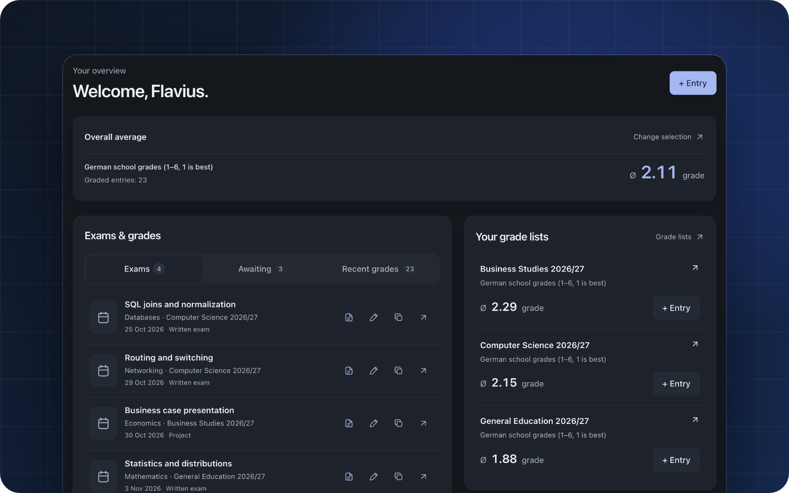
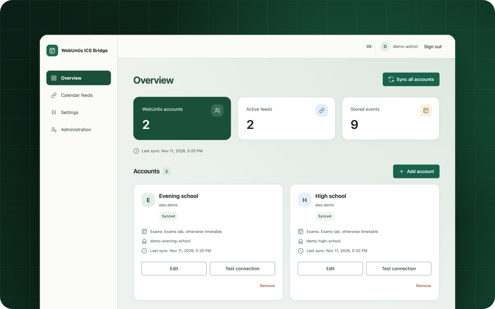

  

  <a href="https://14flavius.dev"><strong>Website</strong></a> &nbsp;·&nbsp;
  <a href="https://www.linkedin.com/in/flavius-hager/">LinkedIn</a> &nbsp;·&nbsp;
  <a href="https://instagram.com/flavius.hager">Instagram</a> &nbsp;·&nbsp;
  <a href="mailto:Kontakt@14flavius.dev">Email</a>

Hi, I'm Flavius. I'm doing an apprenticeship in IT system integration at **[Hetzner](https://www.hetzner.com)** in Nuremberg.

On the side I build small self-hosted tools, mostly because I needed them myself. Day to day it's Linux, networking and hardware. The tools are written in TypeScript and ship as Docker containers.

## Projects

<table width="100%">
  <tr>
    <td width="50%" valign="top">
      
      <h3>GradeShelf</h3>
      
Grade tracker and exam planner you host yourself. Weighted averages, notes, attachments and separate accounts for everyone on the instance.

      

        <a href="https://github.com/14flavius/GradeShelf"><strong>Repository</strong></a> &nbsp;·&nbsp;
        <a href="https://gradeshelf.de">gradeshelf.de</a>
      

    </td>
    <td width="50%" valign="top">
      
      <h3>WebUntis ICS Bridge</h3>
      
Puts your WebUntis timetable into Apple Calendar, Outlook or any other calendar app. Several accounts, and you choose what goes into each feed.

      

        <a href="https://github.com/14flavius/WebUntis-ICS-Bridge"><strong>Repository</strong></a>
      

    </td>
  </tr>
</table>
